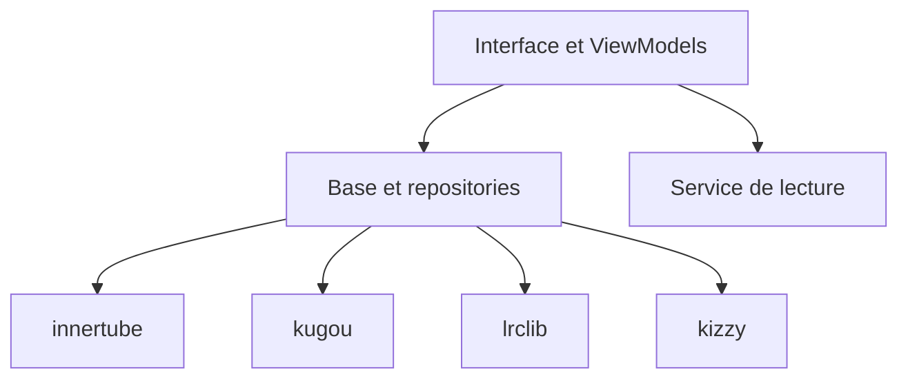

# Maloy-Android/Muzza

> Client Android Material 3 pour YouTube Music, avec lecture sans publicité et paroles synchronisées.

## Le problème
L'application officielle impose publicités, abonnement et peu de réglages pour l'écoute en arrière-plan.

## Ce que ça fait vraiment
Application multi-modules Kotlin. Le module InnerTube parle à YouTube Music, Kugou et Lrclib fournissent des paroles, Kizzy gère Discord. Cache et téléchargement hors ligne, import Spotify, crossfade, normalisation audio, Android Auto.

## Comment c'est branché

## Essayer
Aucune commande dans le README : les APK se téléchargent depuis le canal Telegram indiqué.

## Coût et pièges
Gratuit. Dépend de YouTube Music : inutilisable dans une région non supportée sans proxy ou VPN. Distribution par Telegram, hors stores.

## Ce que ce n'est pas
Pas un service officiel : il contourne le modèle publicitaire de YouTube Music, ce qui peut enfreindre ses conditions. Rien à voir avec la data.

## Alternatives
Aucune alternative citée dans le README. Le README remercie InnerTune, OuterTune, Metrolist et OpenTune dont il s'inspire.

## Pour toi
À ignorer : application de loisir hors de ton périmètre, qui s'appuie sur un service tiers non officiel.

