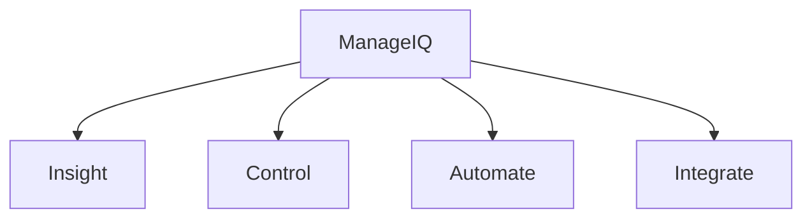

# ManageIQ/manageiq

> Open source hybrid IT management platform: containers, virtual machines, networks and storage.

## The problem
Managing hybrid environments forces you to juggle several consoles and policies.

## What it actually does
The README only details the domains: discovery, monitoring, reporting, chargeback, compliance, alerting, provisioning, orchestration, CMDB integration and web services. The internals are not documented here.

## How it is wired
Simplified diagram based on the fiche, no diagram provided.

## Trying it
No documented commands. The README suggests downloading the community builds for your platform, without a command.

## Cost and gotchas
Free. The operating cost is not documented. An export notice imposes legal restrictions (US EAR regulations).

## What it is not
Not a data science tool. No installation guide in this README: it points to external links.

## Alternatives
No alternative named in the README.

## For you
Ignore: enterprise infrastructure administration platform, far from everyday data / AI / MLOps work.
