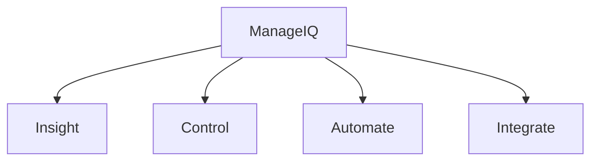

# ManageIQ/manageiq

> Plateforme open source de gestion d'IT hybride : conteneurs, machines virtuelles, réseaux et stockage.

## Le problème
Gérer des environnements hybrides oblige à jongler entre plusieurs consoles et politiques.

## Ce que ça fait vraiment
Le README ne détaille que les domaines : découverte, supervision, rapports, refacturation, conformité, alertes, provisionnement, orchestration, intégration CMDB et services web. Le fonctionnement interne n'est pas documenté ici.

## Comment c'est branché
Schéma simplifié d'après la fiche, sans diagramme fourni.

## Essayer
Aucune commande documentée. Le README propose de télécharger les builds communautaires pour sa plateforme, sans commande.

## Coût et pièges
Gratuit. Le coût d'exploitation n'est pas documenté. Une notice d'export impose des restrictions légales (réglementation américaine EAR).

## Ce que ce n'est pas
Pas un outil de data science. Pas de guide d'installation dans ce README : il renvoie à des liens externes.

## Alternatives
Aucune alternative nommée dans le README.

## Pour toi
À ignorer : plateforme d'administration d'infrastructure d'entreprise, éloignée du travail data / IA / MLOps courant.

