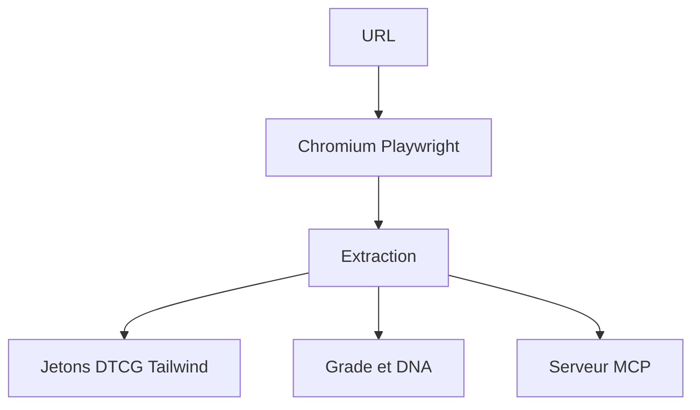

# Manavarya09/design-extract

> CLI that reads a website's design system and extracts tokens, themes and reports from it.

## The problem
Rebuilding a site's colors, fonts and spacing by hand in order to reuse them is slow and approximate.

## What it actually does
`designlang` opens the page in a real browser (Playwright) and extracts design tokens, Tailwind, shadcn, Figma variables, motion and brand voice. It scores how generic a design looks (`slop`), checks a UI against a style guide (`verify-ui`), compares a clone to the original (`fidelity`) and exposes an MCP server for Claude Code and Cursor. No account or key required.

## How it is wired
Simplified diagram based on the sheet, no diagram provided.


## Trying it
```bash
npx designlang https://stripe.com
npx designlang slop https://yoursite.com
npx designlang mcp
npm i -g designlang
```

## Cost and gotchas
Free, Node.js 20+, Chromium must be downloaded (`designlang install-browser`). The `--smart` option may use an OpenAI, Anthropic or Atlas Cloud key.

## What it is not
Not a design generator: it measures and extracts. The scores are in-house heuristics, and copying third-party sites raises rights questions. README truncated in the source.

## Alternatives
No alternative named in the README.

## For you
Ignore for a data/AI/MLOps profile: useful to front-end teams, unrelated to your field.
