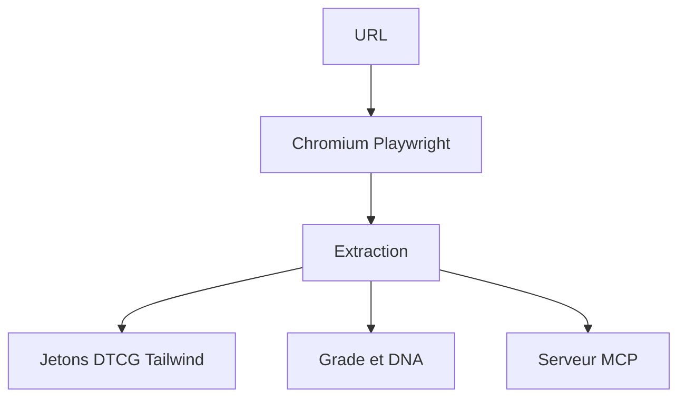

# Manavarya09/design-extract

> CLI qui lit le système de design d'un site web et en tire des jetons, thèmes et rapports.

## Le problème
Reconstituer à la main les couleurs, polices et espacements d'un site pour les réutiliser est long et approximatif.

## Ce que ça fait vraiment
`designlang` ouvre la page dans un vrai navigateur (Playwright) et extrait jetons de design, Tailwind, shadcn, variables Figma, mouvement et voix de marque. Il note le caractère générique (`slop`), vérifie une interface contre une charte (`verify-ui`), compare un clone à l'original (`fidelity`) et expose un serveur MCP pour Claude Code et Cursor. Aucun compte ni clé requis.

## Comment c'est branché
Schéma simplifié d'après la fiche, sans diagramme fourni.


## Essayer
```bash
npx designlang https://stripe.com
npx designlang slop https://yoursite.com
npx designlang mcp
npm i -g designlang
```

## Coût et pièges
Gratuit, Node.js 20+, Chromium à télécharger (`designlang install-browser`). L'option `--smart` peut utiliser une clé OpenAI, Anthropic ou Atlas Cloud.

## Ce que ce n'est pas
Pas un générateur de design : il mesure et extrait. Les scores sont des heuristiques maison, et le copier de sites tiers pose des questions de droits. README tronqué dans la source.

## Alternatives
Aucune alternative nommée dans le README.

## Pour toi
À ignorer pour un profil data/IA/MLOps : utile aux équipes front-end, sans lien avec ton métier.

