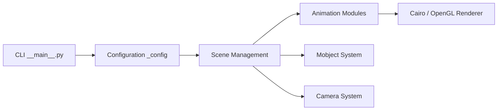

# ManimCommunity/manim

> Python animation engine for building explanatory math videos by code, for teachers and science communicators.

## The problem
Animating a proof or a curve precisely by hand in video editing software is slow and hard to reproduce.

## What it actually does
You describe a `Scene` in Python (shapes, transformations, fades) and the `manim` command produces the video. It handles text, graphs, 3D objects and two rendering engines (Cairo and OpenGL). An IPython magic `%%manim` is available in Jupyter. This community version is a fork of the 3Blue1Brown repository (3b1b/manim).

## How it is wired


## Trying it
```bash
manim -p -ql example.py SquareToCircle
```

## Cost and gotchas
Free. Dependencies must be installed before use: the procedure is pointed to the documentation and not detailed in the README. A Docker image `manimcommunity/manim` exists. Do not mix with the 3b1b/manim instructions.

## What it is not
Not an interactive data visualization tool: it produces rendered videos.

## Alternatives
- 3b1b/manim: the original version by Grant Sanderson, less recommended by the README.

## For you
Watch: interesting for animating the explanation of a model or algorithm in a video, but of no use for pipelines.
