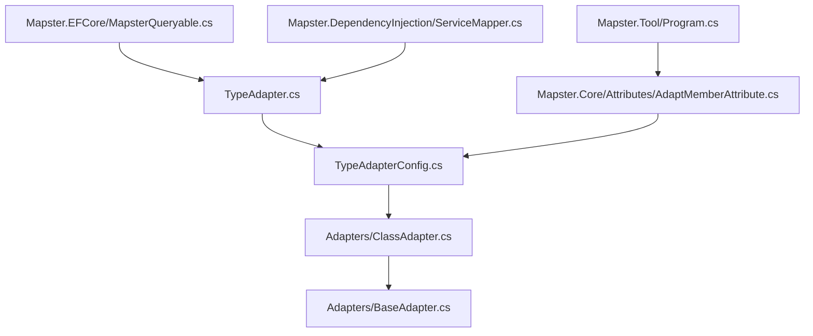

# MapsterMapper/Mapster

> .NET library that automatically copies fields from one object to another, for C# developers.

## The problem
Hand-writing mapping methods between entities and DTOs is repetitive and error-prone.

## What it actually does
Mapster generates the mapping via `Adapt<T>()`, to a new object or an existing one. It offers dependency injection, EF Core query projection (`ProjectToType`) and compile-time code generation with Mapster.Tool. The README publishes its benchmarks against AutoMapper, Mapperly and Facet.

## How it is wired


## Trying it
```bash
dotnet add package Mapster --project <PROJECT_NAME>
```
```csharp
var destObject = sourceObject.Adapt<Destination>();
```

## Cost and gotchas
Free (MIT). You need a .NET project; the performance figures are given for a simple case (`FlatTypes`) and vary with nested objects.

## What it is not
Not a data or AI tool: it is a C# application-layer utility. It does not replace model validation.

## Alternatives
- AutoMapper: historical reference, slower in the README's benchmark.
- Mapperly: compile-time code generation, similar performance.
- Facet: another approach cited in the benchmark.

## For you
Ignore unless you write C#: unrelated to data, AI or MLOps pipelines.
