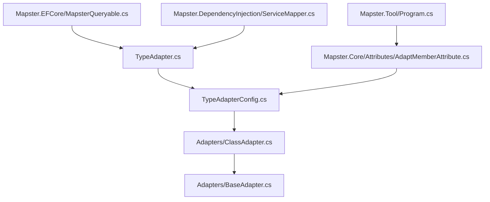

# MapsterMapper/Mapster

> Bibliothèque .NET qui copie automatiquement les champs d'un objet vers un autre, pour développeurs C#.

## Le problème
Écrire à la main des méthodes de mappage entre entités et DTO est répétitif et source d'erreurs.

## Ce que ça fait vraiment
Mapster génère le mappage via `Adapt<T>()`, vers un nouvel objet ou un objet existant. Il propose l'injection de dépendances, la projection de requêtes EF Core (`ProjectToType`) et la génération de code à la compilation avec Mapster.Tool. Le README publie ses benchmarks face à AutoMapper, Mapperly et Facet.

## Comment c'est branché


## Essayer
```bash
dotnet add package Mapster --project <PROJECT_NAME>
```
```csharp
var destObject = sourceObject.Adapt<Destination>();
```

## Coût et pièges
Gratuit (MIT). Il faut un projet .NET ; les chiffres de performance sont donnés pour un cas simple (`FlatTypes`) et varient avec les objets imbriqués.

## Ce que ce n'est pas
Pas un outil de données ni d'IA : c'est un utilitaire de couche applicative C#. Il ne remplace pas la validation des modèles.

## Alternatives
- AutoMapper : référence historique, plus lente dans le benchmark du README.
- Mapperly : génération de code à la compilation, performances proches.
- Facet : autre approche citée dans le benchmark.

## Pour toi
À ignorer sauf si tu écris du C# : sans lien avec les pipelines data, IA ou MLOps.

