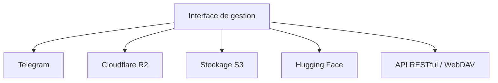

# MarSeventh/CloudFlare-ImgBed

> Self-hosted image and file host for Docker and serverless, multi-storage.

## The problem
Hosting images and files means juggling Telegram, Discord, R2, S3, Hugging Face, WebDAV — each with its own management, with no single interface.

## What it actually does
Brings together Telegram, Discord, Cloudflare R2, S3-compatible storage, Hugging Face, WebDAV in one management interface. File management, authentication, directory organization, content moderation, RESTful and WebDAV API. For personal image hosting, site assets and lightweight distribution. Plugin ecosystem (browser extensions, Typecho/WordPress/Obsidian). Evolved from Telegraph-Image.

## How it is wired

## Trying it
No installation command in the README (it points to the deployment documentation). Write it up: see the project's full documentation.

## Cost and gotchas
Free to host; depends on third-party storage SaaS (R2, Telegram, S3…) and accounts to create. Single maintainer.

## What it is not
Not storage itself: a management facade on top of third-party backends.

## Alternatives
- cf-pages/Telegraph-Image: the upstream project it derives from.

## For you
Outside the data/AI scope: mainstream image hosting — ignore.
