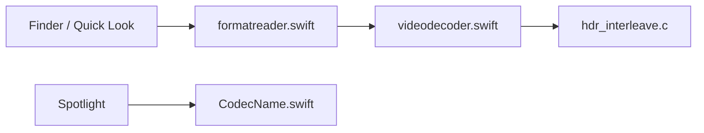

# Marginal/QLVideo

> Thumbnails, Quick Look previews and Finder metadata for non-native video and audio formats on macOS.

## The problem
macOS does not preview MKV, WebM, AVI or many codecs.

## What it actually does
A Spotlight extension and two media extensions add playback of non-native formats and codecs to AVFoundation. The format reader, decoders and contact sheets are in the tree. The README points to a getting-started and troubleshooting guide.

## How it is wired

## Trying it
No command documented in the README ("See Getting Started"). A version is on the App Store.

## Cost and gotchas
Free on the repository side; macOS only, as a Quick Look extension to install.

## What it is not
Not a video player nor a converter. Note: another repository, Marginal/QuickLookVideo, has an identical README.

## Alternatives
Perian, an old QuickTime equivalent cited in the README.

## For you
macOS convenience unrelated to data/AI work: ignore.
