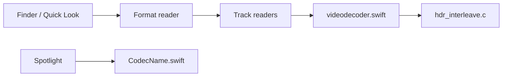

# Marginal/QuickLookVideo

> Thumbnails and Quick Look previews for non-native video and audio formats on macOS.

## The problem
macOS cannot preview MKV, WebM, AVI or many codecs.

## What it actually does
Same README as Marginal/QLVideo: one Spotlight extension and two media extensions for AVFoundation. The graph mentions the format reader, track readers, decoder selection, contact sheets and a test player (`simpleplayer.swift`). Internal calls are not confirmed.

## How it is wired

## Trying it
No command documented in the README ("See Getting Started").

## Cost and gotchas
Free on the repository side; macOS only, as a Quick Look extension to install.

## What it is not
Not a video player. Probably a duplicate or mirror of Marginal/QLVideo: relationship not specified.

## Alternatives
Perian, an older equivalent mentioned in the README.

## For you
Unrelated to data/AI work, and a duplicate of another repository: ignore.
