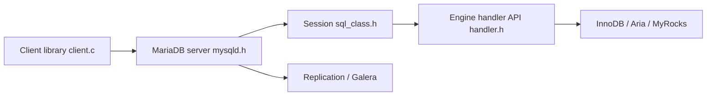

# MariaDB/server

> MySQL-compatible relational database server, with native vector search since 11.8.

## The problem
You need a free, MySQL-compatible SQL database that also handles similarity search without an external extension.

## What it actually does
SQL server with pluggable storage engines (InnoDB, Aria, MyRocks, ColumnStore, Spider, S3), asynchronous and semi-synchronous replication, Galera cluster, recursive CTEs, windowing, temporal tables, JSON functions, GIS, full text, roles and encryption. VECTOR type with HNSW index since 11.8.

## How it is wired

## Trying it
No documented command. The README points to mariadb.org/download for packages and to the developer guide for building.

## Cost and gotchas
Free. GPL v2 licence without the "any later version" clause. LTS versions are maintained for three years, rolling releases for less.

## What it is not
Not a specialized vector database: vector search is one feature among others. Performance is not quantified in the README.

## Alternatives
- MySQL: the database MariaDB was forked from, with high compatibility.

## For you
Watch: the native VECTOR type lets you try semantic search in an SQL database you already know, without adding a service.
