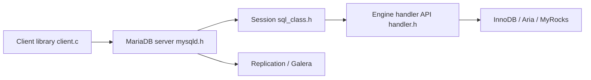

# MariaDB/server

> Serveur de base de données relationnelle compatible MySQL, avec recherche vectorielle native depuis la 11.8.

## Le problème
Il faut une base SQL libre, compatible MySQL, qui gère aussi la recherche de similarité sans extension externe.

## Ce que ça fait vraiment
Serveur SQL avec moteurs de stockage enfichables (InnoDB, Aria, MyRocks, ColumnStore, Spider, S3), réplication asynchrone et semi-synchrone, cluster Galera, CTE récursives, fenêtrage, tables temporelles, fonctions JSON, SIG, plein texte, rôles et chiffrement. Type VECTOR avec index HNSW depuis la 11.8.

## Comment c'est branché

## Essayer
Aucune commande documentée. Le README renvoie vers mariadb.org/download pour les paquets et vers le guide développeur pour la compilation.

## Coût et pièges
Gratuit. Licence GPL v2 sans la clause « toute version ultérieure ». Versions LTS maintenues trois ans, versions glissantes plus courtes.

## Ce que ce n'est pas
Pas une base vectorielle spécialisée : la recherche vectorielle est une fonction parmi d'autres. Performances non chiffrées dans le README.

## Alternatives
- MySQL : base dont MariaDB est issue, avec compatibilité élevée.

## Pour toi
À surveiller : le type VECTOR natif permet de tester la recherche sémantique dans une base SQL déjà connue, sans ajouter de service.

