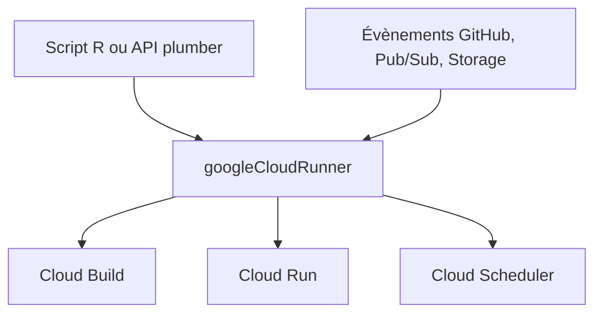

# MarkEdmondson1234/googleCloudRunner

> R package for running R scripts on Google Cloud with Cloud Run, Cloud Build and Cloud Scheduler.

## The problem
Putting a scheduled R script, or a plumber API, into production in the cloud requires a lot of manual configuration.

## What it actually does
R functions to deploy plumber APIs on Cloud Run, run scripts via Cloud Build, schedule them with Cloud Scheduler, and react to GitHub, Pub/Sub and Cloud Storage events. An integration with targets exists. The README is only a table of contents and points to a website.

## How it is wired
Simplified diagram based on the sheet, no diagram provided.



## Trying it
```bash
# Dans R :
install.packages("googleCloudRunner")
remotes::install_github("MarkEdmondson1234/googleCloudRunner")
```

## Cost and gotchas
A Google Cloud account is mandatory; use of the services is billed to you. Last push in June 2025; not an official Google product.

## What it is not
Not an official Google product. It does not work without the GCP ecosystem.

## Alternatives
- No alternative named in the README.

## For you
Watch: interesting if you deploy R analysis on GCP, but dependent on a single maintainer and a specific cloud.
