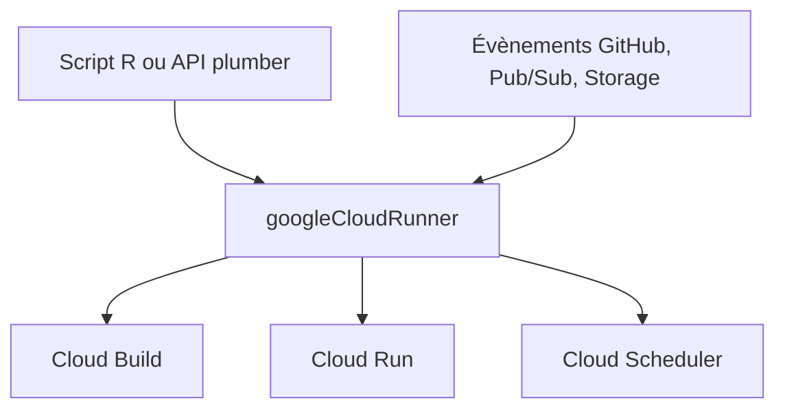

# MarkEdmondson1234/googleCloudRunner

> Paquet R pour lancer des scripts R sur Google Cloud avec Cloud Run, Cloud Build et Cloud Scheduler.

## Le problème
Mettre en production un script R planifié, ou une API plumber, sur le cloud demande beaucoup de configuration à la main.

## Ce que ça fait vraiment
Fonctions R pour déployer des API plumber sur Cloud Run, exécuter des scripts via Cloud Build, les planifier avec Cloud Scheduler, et réagir aux évènements GitHub, Pub/Sub et Cloud Storage. Une intégration avec targets existe. Le README n'est qu'un sommaire et renvoie vers un site.

## Comment c'est branché
Schéma simplifié d'après la fiche, sans diagramme fourni.



## Essayer
```bash
# Dans R :
install.packages("googleCloudRunner")
remotes::install_github("MarkEdmondson1234/googleCloudRunner")
```

## Coût et pièges
Un compte Google Cloud est obligatoire ; l'usage des services est facturé à ta charge. Dernier push en juin 2025 ; pas un produit Google officiel.

## Ce que ce n'est pas
Pas un produit officiel de Google. Il ne fonctionne pas sans l'écosystème GCP.

## Alternatives
- Aucune alternative nommée dans le README.

## Pour toi
Surveiller : intéressant si tu déploies de l'analyse R sur GCP, mais dépendant d'un seul mainteneur et d'un cloud précis.

