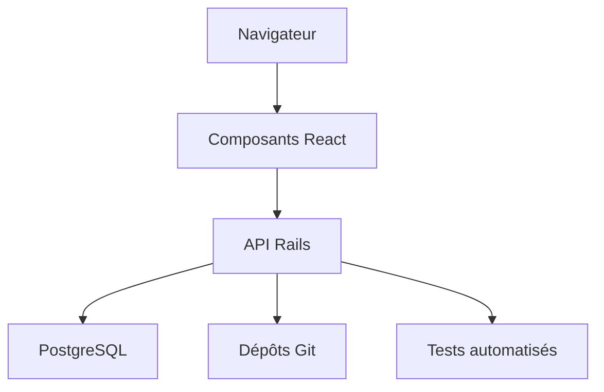

# MarkUsProject/Markus

> Rails and React web application for submitting and grading student assignments, in universities.

## The problem
Graders need annotation and marking tools, and students need a simple place to submit their work.

## What it actually does
Student files are stored with git; submission through the web interface or version control, group formation, code annotation, course administration, grade publication. According to the architecture: automated tests, LTI integration, WebSockets, background jobs.

## How it is wired

## Trying it
No command in the README: it points to the production, Docker or Vagrant installation guides.

## Cost and gotchas
Heavy production installation (Rails, PostgreSQL, Git, Redis according to the diagram). Read the installation guide hosted elsewhere.

## What it is not
Not a full LMS. Not an automatic grading tool on its own.

## Alternatives
No alternative named in the README.

## For you
Ignore: assignment grading tool, useful to teachers, not to a data/AI/MLOps profile.
