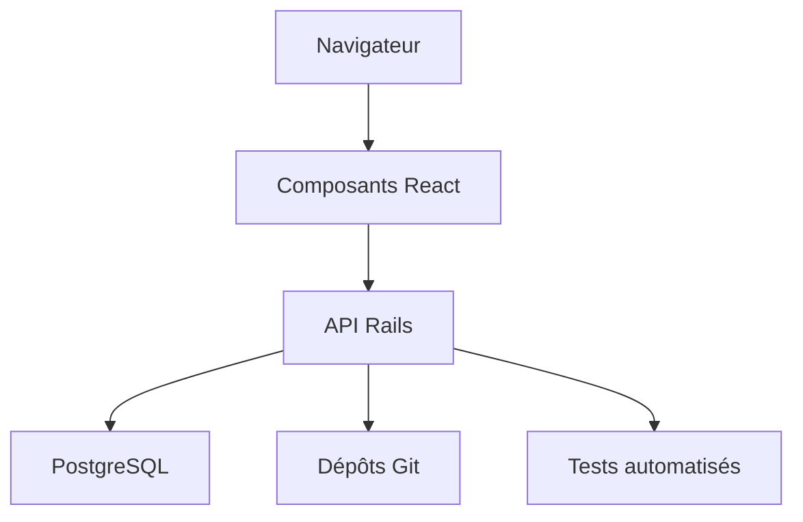

# MarkUsProject/Markus

> Application web Rails et React pour déposer et corriger des devoirs d'étudiants, en universités.

## Le problème
Les correcteurs ont besoin d'outils d'annotation et de notation, et les étudiants d'un lieu simple de dépôt.

## Ce que ça fait vraiment
Les fichiers étudiants sont stockés avec git ; dépôt par interface web ou contrôle de version, formation de groupes, annotation du code, administration de cours, publication des notes. D'après l'architecture : tests automatisés, intégration LTI, WebSockets, jobs en arrière-plan.

## Comment c'est branché

## Essayer
Aucune commande dans le README : renvoie aux guides d'installation en production, Docker ou Vagrant.

## Coût et pièges
Installation de production lourde (Rails, PostgreSQL, Git, Redis selon le diagramme). Lire le guide d'installation hébergé ailleurs.

## Ce que ce n'est pas
Pas un LMS complet. Pas un outil de notation automatique seul.

## Alternatives
Aucune alternative nommée dans le README.

## Pour toi
Ignorer : outil de correction de devoirs, utile aux enseignants, pas à un profil data/IA/MLOps.

