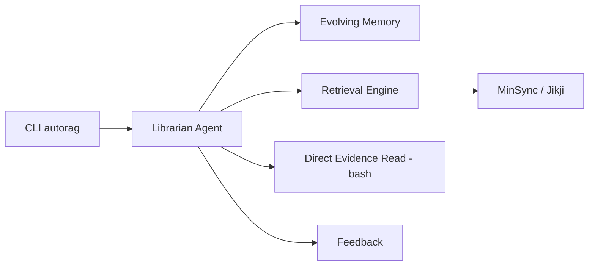

# Marker-Inc-Korea/AutoRAG

> Librarian agent that searches your documents in place, verifies sources and returns numbered results.

## The problem
Search engines return paths and lines; classic RAGs force you to copy your data into a central vector database.

## What it actually does
This repository now hosts AutoRAG 2.0 (agent, `@autorag/librarian` package); the former RAG pipeline AutoML has moved to `legacy/` and is maintained in maintenance mode. The agent consults a memory, searches by BM25, vectors or hybrid (MinSync), opens files with `bash` to verify, then returns numbered units. A Lite mode works without an LLM.

## How it is wired


## Trying it
```bash
npm install -g @autorag/librarian
autorag init --search-paths ~/Documents/research
autorag refresh
autorag search "What are our primary Q3 deliverables?"
```

## Cost and gotchas
Node ≥ 24 or Bun, Java 11+ to read PDFs, a configured reasoning model (tokens at your expense). The agent reads your files with shell commands: reserve it for folders you accept to expose. License not identified by GitHub.

## What it is not
Not the earlier Python AutoRAG: `pip install AutoRAG` corresponds to the legacy version. Several subsystems are described only by the README.

## Alternatives
AutoRAG legacy (in `legacy/`) for RAG pipeline optimization.

## For you
Worth watching: an interesting "no data migration" approach, but young, in TypeScript, and with a license to clarify.
