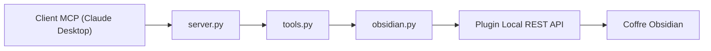

# MarkusPfundstein/mcp-obsidian

> MCP server that lets an assistant read, search and modify an Obsidian vault.

## The problem
Getting an assistant to work on your Obsidian notes without copy-pasting.

## What it actually does
The server goes through Obsidian's community "Local REST API" plugin and exposes seven tools: list files and folders, read a file, search, insert into a note (heading, block, frontmatter), append content and delete. Configured through the variables `OBSIDIAN_API_KEY`, `OBSIDIAN_HOST`, `OBSIDIAN_PORT`. The `mcp` SDK version must stay on 1.x.

## How it is wired


## Trying it
```bash
# Configuration Claude Desktop (extrait du README) :
#   "command": "uvx", "args": ["mcp-obsidian"],
#   "env": {"OBSIDIAN_API_KEY": "<clé>", "OBSIDIAN_HOST": "<hôte>", "OBSIDIAN_PORT": "<port>"}
docker compose build
docker compose run --rm -T mcp-obsidian
```

## Cost and gotchas
Free; requires the REST API plugin to be active and its key. The README specifies `mcp` ≥ 1.1.0 and < 2.0.0: with `mcp` 2.0, the server crashes on import.

## What it is not
Not an Obsidian plugin: it is an external bridge. The `delete_file` tool can delete notes.

## Alternatives
- obsidian-local-rest-api: the plugin it relies on, if you want to call the API directly.

## For you
To adopt: small, easy to install and directly useful for connecting your notes to an assistant; keep backups of the vault because of the deletion tool.
