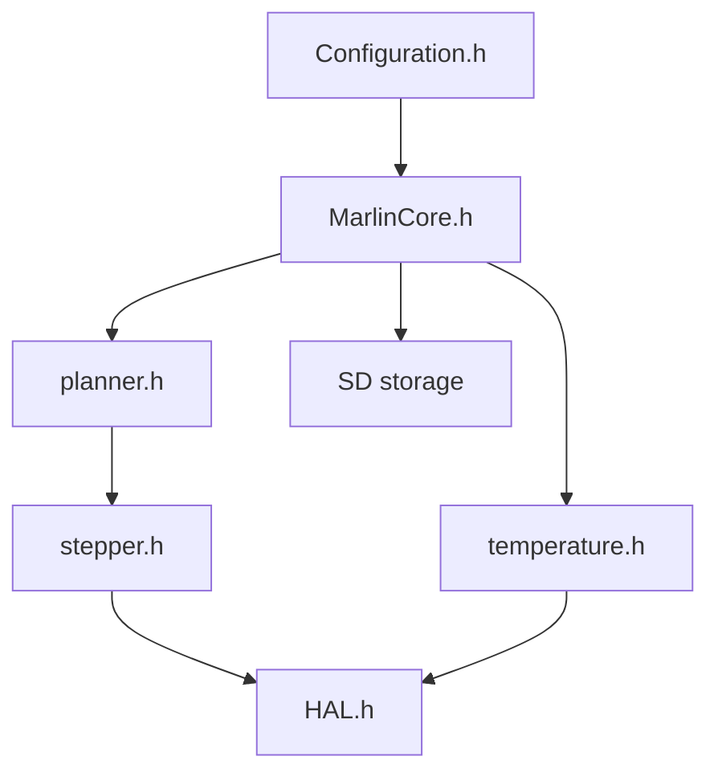

# MarlinFirmware/Marlin

> Configurable open source firmware for 3D printers, running on 8-bit AVR and 32-bit ARM boards.

## The problem
Driving the motors, heaters and display of a 3D printer with software that can be adapted to hundreds of machines.

## What it actually does
Receives commands, plans coordinated motion (up to 9 axes, 8 extruders), manages thermal control and drives the hardware through an abstraction layer (HAL for AVR, STM32, ESP32, LPC1768, RP2040 in beta). Configuration is done through files dedicated to each machine.

## How it is wired
Diagram based on the code's own diagram, simplified.

## Trying it
No command in the README: build through VS Code with PlatformIO or the Auto Build Marlin extension, a devcontainer, or the Arduino IDE.

## Cost and gotchas
Free (GPL-3.0). You need a compatible board and the machine's configuration (MarlinFirmware/Configurations repository). The 2.1 "bugfix" branch is flagged "not for production".

## What it is not
Not slicing software (a slicer). Not a desktop tool: it is installed on the printer's board.

## Alternatives
None named in the README.

## For you
Ignore: embedded 3D printer firmware, outside your data / AI / MLOps scope, except as a hobby.
