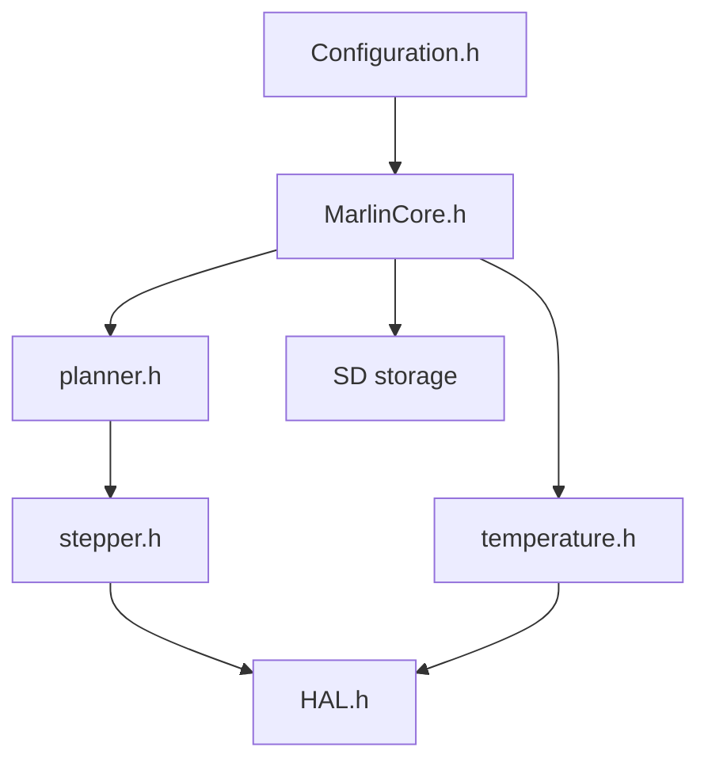

# MarlinFirmware/Marlin

> Firmware open source configurable pour imprimantes 3D, cartes 8 bits AVR et 32 bits ARM.

## Le problème
Piloter moteurs, chauffages et écran d'une imprimante 3D avec un logiciel adaptable à des centaines de machines.

## Ce que ça fait vraiment
Reçoit des commandes, planifie les mouvements coordonnés (jusqu'à 9 axes, 8 extrudeurs), gère la thermique et pilote le matériel via une couche d'abstraction (HAL pour AVR, STM32, ESP32, LPC1768, RP2040 en beta). Configuration par fichiers dédiés à chaque machine.

## Comment c'est branché
Schéma d'après le diagramme du code, simplifié.

## Essayer
Aucune commande dans le README : compilation via VS Code avec PlatformIO ou l'extension Auto Build Marlin, devcontainer ou Arduino IDE.

## Coût et pièges
Gratuit (GPL-3.0). Il faut une carte compatible et la configuration de la machine (dépôt MarlinFirmware/Configurations). La branche 2.1 « bugfix » est signalée « non pour la production ».

## Ce que ce n'est pas
Pas un logiciel de découpe (slicer). Pas un outil pour ordinateur : il s'installe sur la carte de l'imprimante.

## Alternatives
Aucune nommée dans le README.

## Pour toi
À ignorer : firmware embarqué d'imprimante 3D, hors de ton périmètre data / IA / MLOps, sauf loisir.

