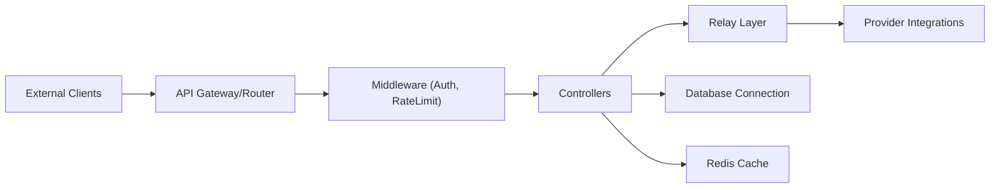

# MartialBE/one-hub

> Self-hosted gateway that unifies access to many LLM providers, with billing and dashboards.

## The problem
Each model provider has its own API, keys and billing. Without a common entry point, it is hard to distribute access to a team or track consumption.

## What it actually does
A fork of one-api, with a database incompatible with the original. A Go (Gin) backend relays requests to OpenAI, Azure, Anthropic, Gemini, Mistral, Groq, Ollama and Chinese providers. It adds a user dashboard, admin statistics, per-model pricing, per-group RPM limits, payment, a Telegram bot, Prometheus metrics. The front end is in React.

## How it is wired

## Trying it
The README documents no install command; it refers to a documentation site and to `config.example.yaml` (mentioned by the architecture). No command is given here.

## Cost and gotchas
You pay the upstream providers with your own keys. The README warns: personal use, no stability or support guaranteed, and compliance with OpenAI's terms. It advises against mixing with the original one-api (incompatible databases).

## What it is not
Not a supported product: the author says so himself. The bundled model list is no longer updated, you have to refresh prices by hand in the admin. README mostly in Chinese.

## Alternatives
- one-api: the original project, of which this is a fork.
- new api: source of the Midjourney/Suno code reused here.

## For you
Worth watching: useful if you must redistribute LLM keys to a team, but with no support and as a fork of a third-party project, install it only knowingly.
