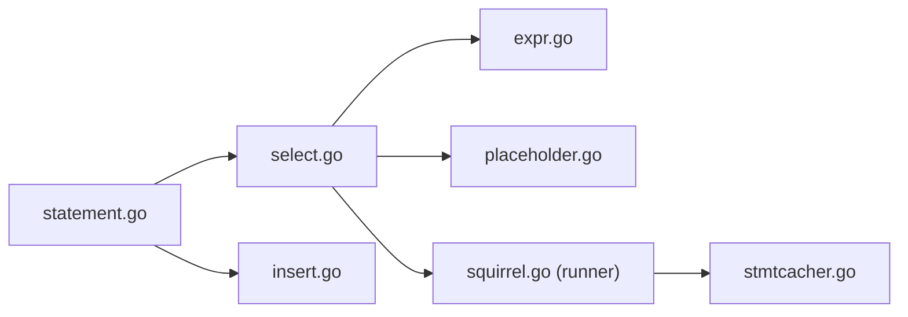

# Masterminds/squirrel

> Fluent SQL query builder for Go, which is not an ORM.

## The problem
Building dynamic SQL queries by string concatenation is fragile in Go.

## What it actually does
Composable SELECT, INSERT, UPDATE, DELETE and CASE builders, with bound arguments, a placeholder format (`Dollar` for PostgreSQL) and execution through a runner (`RunWith`). Prepared statement cache (`StmtCache`) and context-aware variants.

## How it is wired


## Trying it
```go
users := sq.Select("*").From("users").Join("emails USING (email_id)")
sql, args, err := users.Where(sq.Eq{"deleted_at": nil}).ToSql()
```

## Cost and gotchas
Free. The project calls itself "complete": fixes are rare, and issues are not guaranteed a reply (last push April 2024). License not identified by GitHub.

## What it is not
Not an ORM. No tuples in `IN` (workaround via `Or`/`Eq`).

## Alternatives
- structable: a table-to-struct mapper built on squirrel.

## For you
Ignore: little activity and an unclear license; of little interest outside Go services using SQL.
