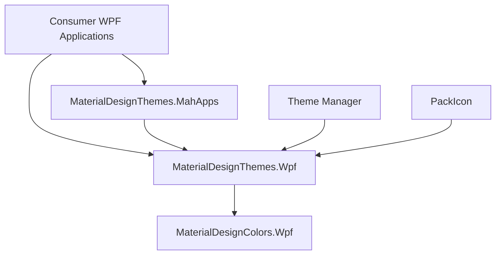

# MaterialDesignInXAML/MaterialDesignInXamlToolkit

> Material Design theme and controls for Windows WPF desktop applications, aimed at .NET developers.

## The problem
Default WPF controls look dated. Reproducing the Material Design style (palettes, cards, dialogs) by hand takes time.

## What it actually does
Provides styles for the standard WPF controls, additional controls (multi-action buttons, cards, dialogs, clock) and an icon pack. The palette can be set at design time and at runtime. Material Design 2 is complete, version 3 is "under development". Compatible with Dragablz and MahApps.

## How it is wired


## Trying it
```bash
Install-Package MaterialDesignThemes
```
Then declare `materialDesign:BundledTheme` in `App.xaml` (snippet provided in the README).

## Cost and gotchas
Free. Visual Studio 2022 and the .NET desktop workload are required to build the sources. WPF only runs on Windows.

## What it is not
Not a web or cross-platform tool: WPF only. The Material Design 3 version is flagged as still a work in progress.

## Alternatives
- MahApps (cited as compatible): another WPF theme library, usable as a complement.
- Material Design Extensions: community repository that adds controls to this library.

## For you
Ignore for a data / AI / MLOps profile: it is Windows desktop UI, unrelated to models or pipelines.
