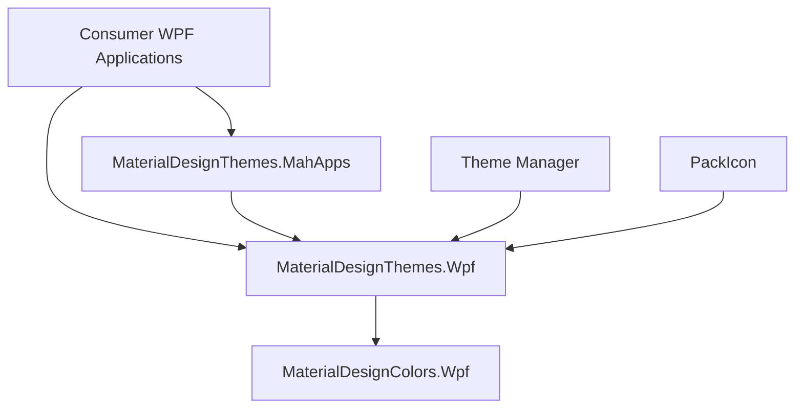

# MaterialDesignInXAML/MaterialDesignInXamlToolkit

> Thème et contrôles Material Design pour applications de bureau Windows WPF, destinés aux développeurs .NET.

## Le problème
Les contrôles WPF par défaut ont un rendu daté. Reproduire à la main le style Material Design (palettes, cartes, dialogues) prend du temps.

## Ce que ça fait vraiment
Fournit des styles pour les contrôles WPF standards, des contrôles additionnels (boutons multi-actions, cartes, dialogues, horloge) et un pack d'icônes. La palette se règle à la conception et à l'exécution. Material Design 2 est complet, la version 3 est « en développement ». Compatible Dragablz et MahApps.

## Comment c'est branché


## Essayer
```bash
Install-Package MaterialDesignThemes
```
Puis déclarer `materialDesign:BundledTheme` dans `App.xaml` (extrait fourni dans le README).

## Coût et pièges
Gratuit. Il faut Visual Studio 2022 et la charge de travail .NET desktop pour compiler les sources. WPF ne tourne que sous Windows.

## Ce que ce n'est pas
Ce n'est pas un outil web ni multiplateforme : uniquement WPF. La version Material Design 3 est signalée comme encore en chantier.

## Alternatives
- MahApps (cité comme compatible) : autre bibliothèque de thèmes WPF, utilisable en complément.
- Material Design Extensions : dépôt communautaire qui ajoute des contrôles à cette bibliothèque.

## Pour toi
À ignorer pour un profil data / IA / MLOps : c'est de l'interface de bureau Windows, sans lien avec les modèles ni les pipelines.

