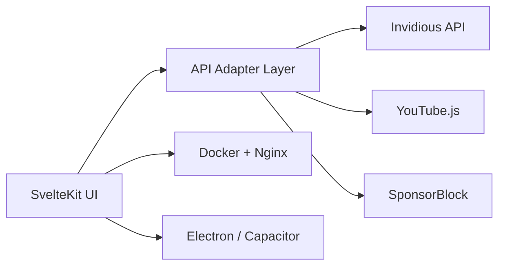

# Materialious/Materialious

> Material-design web, desktop and Android client for YouTube and Invidious instances.

## The problem
Watching YouTube without ads or tracking requires a clean front end; the standard Invidious interface is considered austere.

## What it actually does
A SvelteKit application packaged as web (Docker/Nginx), Electron and Capacitor/Android. Features: optional accounts, encrypted subscriptions, history sync, SponsorBlock, Return YouTube Dislike, DeArrow, chapters, PiP, Android TV. No backend of its own in the analyzed code: calls go to Invidious, YouTube.js and third-party APIs.

## How it is wired

## Trying it
No command is documented in the README (it points to external Docker guides).

## Cost and gotchas
Free; depends on an Invidious instance or the provided YouTube backend. AGPL-3.0 license: sharing obligations if you host a modified version.

## What it is not
Not a monitoring or data tool: a video player. Outside the data/AI scope.

## Alternatives
- Invidious: the base front end (a legacy "Invidious only" version is mentioned).

## For you
Ignore: unrelated to your data/AI/MLOps profile; the only possible interest is as an example of a multi-platform SvelteKit app.
