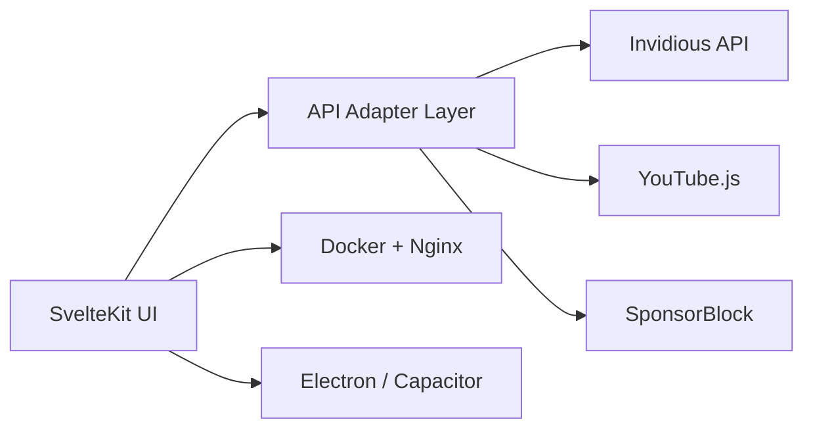

# Materialious/Materialious

> Client web, desktop et Android au design Material pour YouTube et les instances Invidious.

## Le problème
Regarder YouTube sans pub ni pistage demande un front propre ; l'interface Invidious standard est jugée austère.

## Ce que ça fait vraiment
Application SvelteKit empaquetée en web (Docker/Nginx), Electron et Capacitor/Android. Fonctions : comptes optionnels, abonnements chiffrés, synchronisation de l'historique, SponsorBlock, Return YouTube Dislike, DeArrow, chapitres, PiP, Android TV. Pas de backend propre dans le code analysé : appels à Invidious, YouTube.js et aux API tierces.

## Comment c'est branché

## Essayer
Aucune commande n'est documentée dans le README (renvoi à des guides Docker externes).

## Coût et pièges
Gratuit ; dépend d'une instance Invidious ou du backend YouTube fourni. Licence AGPL-3.0 : obligations de partage si tu l'héberges modifié.

## Ce que ce n'est pas
Pas un outil de veille ou de données : un lecteur vidéo. Hors périmètre data/IA.

## Alternatives
- Invidious : frontend de base (version legacy « Invidious only » mentionnée).

## Pour toi
À ignorer : sans rapport avec ton profil data/IA/MLOps ; seul intérêt éventuel, un exemple d'app SvelteKit multi-plateformes.

