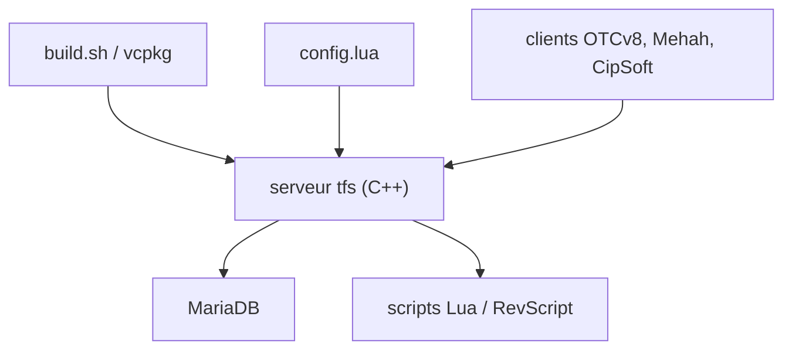

# Mateuzkl/forgottenserver-downgrade-1.8-8.60

> Tibia game server (protocol 8.60) based on TFS 1.8, for private server hosts.

## The problem
Running a classic Tibia 8.60 server on a modern, maintained engine.

## What it actually does
C++23 engine with Lua 5.5 and MariaDB, protocol 8.60, maps and items by ClientID. About twenty optional systems (Forge, Imbuements, Market, Prey, Battle Pass…) are enabled in `config.lua`. Two NPC systems are provided. Game content (maps, quests, monsters) is not included.

## How it is wired
Simplified diagram based on the sheet, no diagram provided.


## Trying it
```bash
chmod +x build.sh
./build.sh
./tfs
```

## Cost and gotchas
Build on Ubuntu, Debian or WSL, or Visual Studio with vcpkg on Windows. MariaDB required. The host must port the content. GPL-2.0 license.

## What it is not
Not a complete turnkey server: it is a clean base without a global datapack.

## Alternatives
No alternative named in the README (cited for origin: Nekiro, MillhioreBT, Crystal, Canary).

## For you
Ignore: game server unrelated to data, AI or MLOps work.
