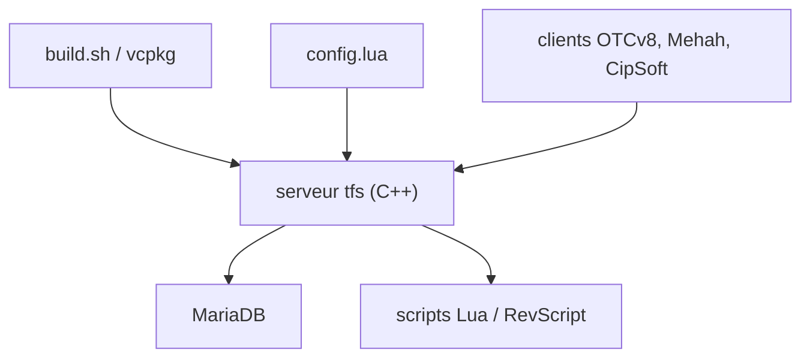

# Mateuzkl/forgottenserver-downgrade-1.8-8.60

> Serveur de jeu Tibia (protocole 8.60) basé sur TFS 1.8, pour hébergeurs de serveurs privés.

## Le problème
Faire tourner un serveur Tibia classique 8.60 sur un moteur moderne et maintenu.

## Ce que ça fait vraiment
Moteur C++23 avec Lua 5.5 et MariaDB, protocole 8.60, cartes et objets par ClientID. Une vingtaine de systèmes optionnels (Forge, Imbuements, Market, Prey, Battle Pass…) s'activent dans `config.lua`. Deux systèmes de PNJ sont fournis. Le contenu de jeu (cartes, quêtes, monstres) n'est pas inclus.

## Comment c'est branché
Schéma simplifié d'après la fiche, sans diagramme fourni.


## Essayer
```bash
chmod +x build.sh
./build.sh
./tfs
```

## Coût et pièges
Compilation sous Ubuntu, Debian ou WSL, ou Visual Studio avec vcpkg sous Windows. MariaDB nécessaire. Le contenu doit être porté par l'hébergeur. Licence GPL-2.0.

## Ce que ce n'est pas
Pas un serveur complet clé en main : c'est une base propre sans datapack global.

## Alternatives
Aucune alternative nommée dans le README (cités pour l'origine : Nekiro, MillhioreBT, Crystal, Canary).

## Pour toi
À ignorer : serveur de jeu sans lien avec un travail data, IA ou MLOps.

