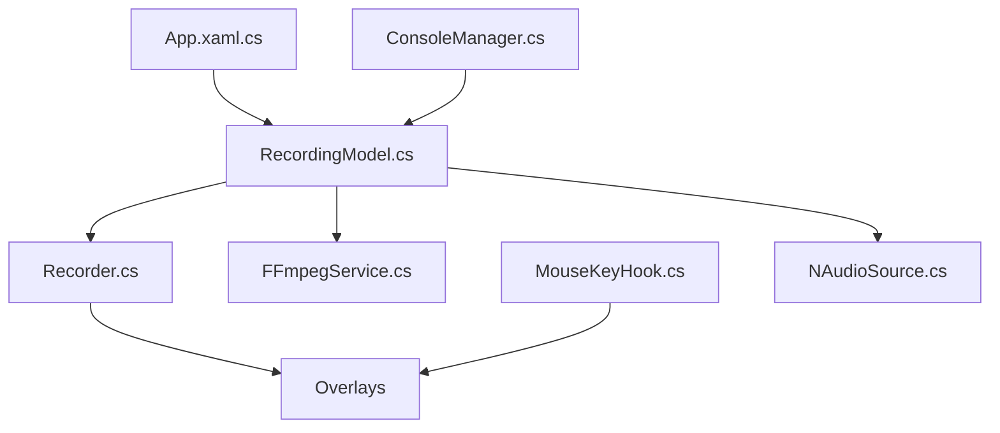

# MathewSachin/Captura

> Windows screen recorder (screen, webcam, audio, clicks, keystrokes) that is no longer actively maintained.

## The problem
Record the screen as AVI, GIF or MP4, with cursor, clicks and keystrokes displayed, without going through a paid tool.

## What it actually does
Windows desktop application with a command-line entry point (beta). It captures screen, window, region or webcam, mixes microphone and speaker output, then writes through FFmpeg or AVI writers. It can also upload to Imgur or YouTube.

## How it is wired


## Trying it
```bash
choco install captura -y
```

## Cost and gotchas
Free. Windows only; FFmpeg is required for MP4. The README announces that the repository is no longer actively maintained.

## What it is not
Not a cross-platform tool. Not a living project: the author points to a web successor (Captura Web Recorder) not detailed in the README.

## Alternatives
No alternative named in the README, apart from the author's web successor.

## For you
To ignore for a data / AI profile: a Windows screen-capture tool, off-topic, and declared unmaintained by its author.
