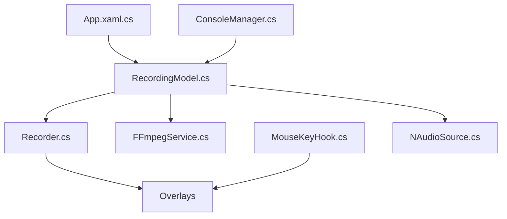

# MathewSachin/Captura

> Enregistreur d'écran Windows (écran, webcam, audio, clics, touches) qui n'est plus maintenu activement.

## Le problème
Enregistrer l'écran en AVI, GIF ou MP4, avec curseur, clics et frappes affichés, sans passer par un outil payant.

## Ce que ça fait vraiment
Application de bureau Windows avec une entrée en ligne de commande (bêta). Elle capture écran, fenêtre, région ou webcam, mixe micro et sortie haut-parleurs, puis écrit via FFmpeg ou des écrivains AVI. Elle peut aussi téléverser vers Imgur ou YouTube.

## Comment c'est branché


## Essayer
```bash
choco install captura -y
```

## Coût et pièges
Gratuit. Windows uniquement ; FFmpeg est nécessaire pour MP4. Le README annonce que le dépôt n'est plus activement maintenu.

## Ce que ce n'est pas
Pas un outil multiplateforme. Pas un projet vivant : l'auteur renvoie vers un successeur web (Captura Web Recorder) non détaillé dans le README.

## Alternatives
Aucune alternative nommée dans le README, hormis le successeur web de l'auteur.

## Pour toi
À ignorer pour un profil data / IA : outil Windows de capture d'écran, hors sujet, et déclaré non maintenu par son auteur.

