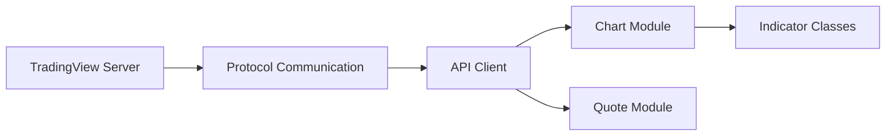

# Mathieu2301/TradingView-API

> Unofficial Node.js client to fetch real-time prices and indicator values from TradingView.

## The problem
TradingView offers no simple public API to read quotes and indicators from code.

## What it actually does
JavaScript library that talks to TradingView servers: chart and quote sessions, built-in and Pine indicators, invite-only indicators, drawings, technical analysis, replay mode (including a fake replay for the free plan), strategy backtests.

## How it is wired


## Trying it
```bash
npm i @mathieuc/tradingview
```

## Cost and gotchas
No license declared: usage rights are uncertain. The service accessed is a third-party SaaS whose terms may forbid this kind of access, which the README does not address. A poll indicates about 100 open issues.

## What it is not
Not an official API: it may break if TradingView changes its protocol. The README also mixes in offers of custom support.

## Alternatives
The README names no alternative.

## For you
Ignore: the lack of a license and the dependence on an unofficial protocol make this client risky for serious use.
