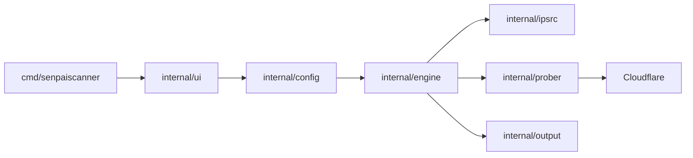

# MatinSenPai/SenPaiScanner

> Cloudflare address scanner that tests latency and throughput from your network, for users on filtered or unstable networks.

## The problem
On a filtered or slow network, not all Cloudflare addresses are equal; finding the ones that respond fast and work with your proxy configuration is done by hand.

## What it actually does
- Samples embedded Cloudflare IPv4 ranges (or reads an `ips.txt` file), probes each address on one or more ports and measures health, latency, loss, throughput.
- Can validate the best candidates through an embedded Xray core, from `vless://`, `trojan://` or `vmess://` links.
- Exports raw addresses, rewritten links, Base64 subscription, Sing-box JSON or Clash YAML.
- Three interfaces: Wails GUI, Android app, CLI/TUI.

## How it is wired


## Trying it
```bash
chmod +x SenPaiScanner-1.0.0-cli-*
./SenPaiScanner-1.0.0-cli-linux-amd64
senpaiscanner --version
```

## Cost and gotchas
Free. Proxy links often contain credentials: do not post them in issues or screenshots. The README asks to scan only networks and ranges you are authorized to test.

## What it is not
Not a vulnerability scanner nor a proxy: it ranks addresses. Source anomaly: the architecture derived from the code only describes a TUI (Quick/Custom Scan, Test IPs, Discover Colos), whereas the README announces a GUI and Android; what is actually shipped is not verified.

## Alternatives
No alternative named in the README.

## For you
Ignore: unrelated to data/AI/MLOps work, and a young project (created in May 2026) run by a single person.
