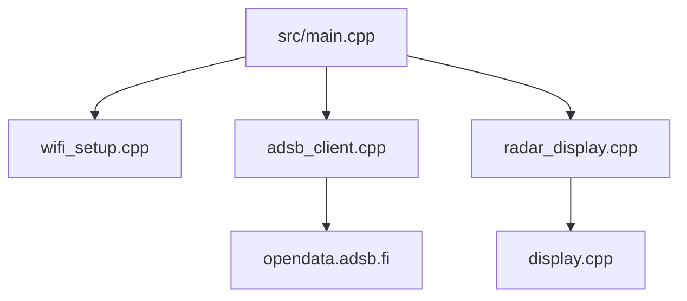

# MatixYo/ESP32-Plane-Radar

> ESP32-C3 firmware that shows nearby aircraft on a round display, based on ADS-B data.

## The problem
Watching live the planes flying over your home requires an app or a website open.

## What it actually does
A circular radar on a 1.28-inch GC9A01 display: rings, heading, speed vector, callsign and altitude, runways of major airports. Data from adsb.fi, refreshed every 5 s. Wi-Fi portal to set network, position and units. The BOOT button changes the range.

## How it is wired


## Trying it
```bash
pio run -t upload
pio device monitor
./scripts/merge-firmware.sh
```

## Cost and gotchas
ESP32-C3 Super Mini hardware and a GC9A01 display to wire up, PlatformIO to build. Depends on the public adsb.fi API and on Wi-Fi. 3D-printed case (STL provided separately).

## What it is not
Not a radio receiver: it does not pick up aircraft, it reads an online API.

## Alternatives
No alternative named in the README.

## For you
Ignore: an electronics DIY project, unrelated to data / AI / MLOps work.
