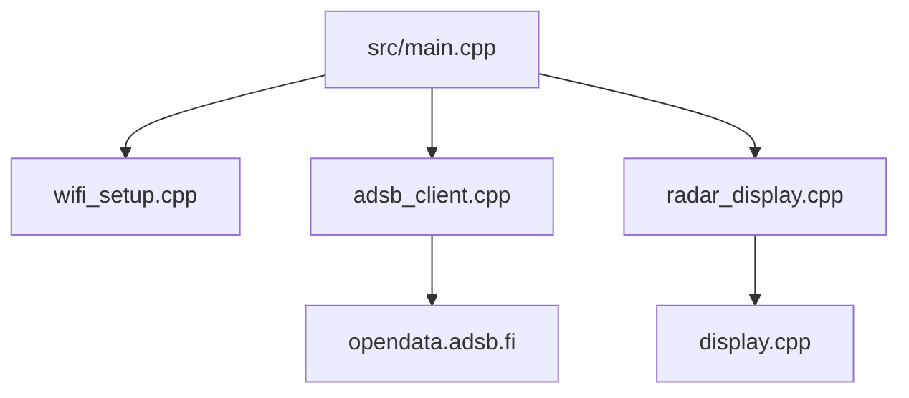

# MatixYo/ESP32-Plane-Radar

> Firmware ESP32-C3 qui affiche sur un écran rond les avions proches, d'après les données ADS-B.

## Le problème
Voir en direct les avions qui survolent chez soi demande une appli ou un site ouvert.

## Ce que ça fait vraiment
Un radar circulaire sur écran GC9A01 de 1,28 pouce : anneaux, cap, vecteur de vitesse, indicatif et altitude, pistes de grands aéroports. Données d'adsb.fi, rafraîchies toutes les 5 s. Portail Wi-Fi pour régler réseau, position et unités. Le bouton BOOT change la portée.

## Comment c'est branché


## Essayer
```bash
pio run -t upload
pio device monitor
./scripts/merge-firmware.sh
```

## Coût et pièges
Matériel ESP32-C3 Super Mini et écran GC9A01 à câbler, PlatformIO pour compiler. Dépend de l'API publique adsb.fi et d'un Wi-Fi. Boîtier imprimé en 3D (STL à part).

## Ce que ce n'est pas
Pas un récepteur radio : il ne capte pas les avions, il lit une API en ligne.

## Alternatives
Aucune alternative nommée dans le README.

## Pour toi
Ignorer : projet de bricolage électronique, sans rapport avec un travail data / IA / MLOps.

