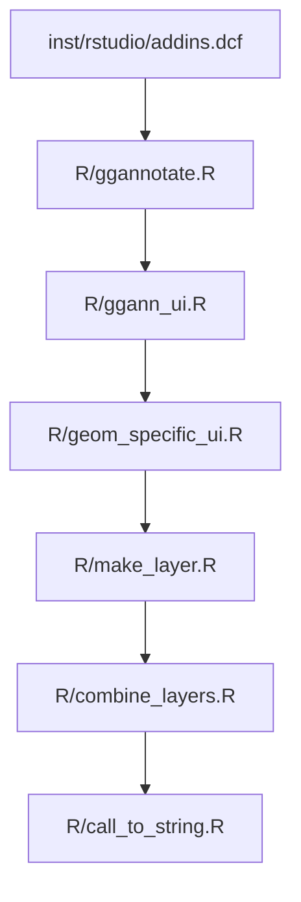

# MattCowgill/ggannotate

> A Shiny gadget to place annotations on a ggplot2 chart by clicking, and retrieve the code.

## The problem
Positioning text, boxes and curves on a chart by hand is tedious.

## What it actually does
`ggannotate()` opens a Shiny gadget: you click on the chart to place text, labels, curves or rectangles, including on faceted charts. Annotations of the same type are merged into a single layer. The code can be copied in one click, with an RStudio addin.

## How it is wired


## Trying it
```r
pak::pak("MattCowgill/ggannotate")
library(ggplot2)
library(ggannotate)
p <- ggplot(mtcars, aes(x = wt, y = mpg)) + geom_point()
ggannotate(p)
```

## Cost and gotchas
Free. You need R, ggplot2 and Shiny; installation from GitHub only. A license is present but not identified by GitHub.

## What it is not
It is not permanent editing: you get code to paste into your script. It only handles ggplot2 charts.

## Alternatives
No alternative named in the README.

## For you
Worth watching if you publish ggplot2 charts in R: it saves you from fiddling with coordinates, with no value outside that case.
