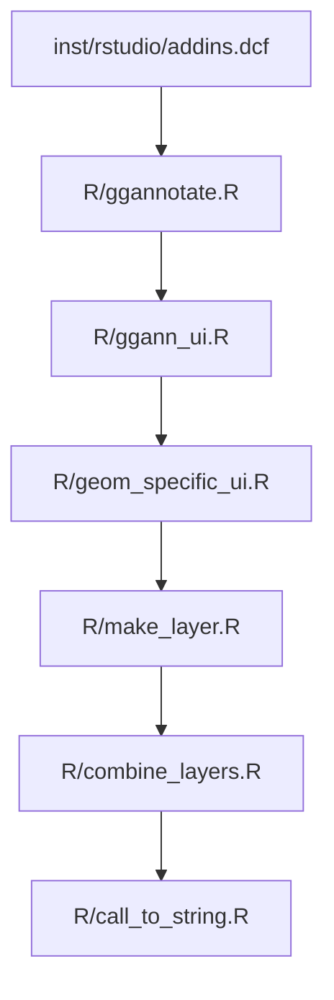

# MattCowgill/ggannotate

> Gadget Shiny pour placer des annotations sur un graphique ggplot2 par clic, et en récupérer le code.

## Le problème
Positionner à la main texte, cadres et courbes sur un graphique est fastidieux.

## Ce que ça fait vraiment
`ggannotate()` ouvre un gadget Shiny : on clique sur le graphique pour placer texte, étiquettes, courbes ou rectangles, y compris sur des graphiques à facettes. Les annotations d'un même type sont fusionnées en une couche. Le code est copiable en un clic, avec un addin RStudio.

## Comment c'est branché


## Essayer
```r
pak::pak("MattCowgill/ggannotate")
library(ggplot2)
library(ggannotate)
p <- ggplot(mtcars, aes(x = wt, y = mpg)) + geom_point()
ggannotate(p)
```

## Coût et pièges
Gratuit. Il faut R, ggplot2 et Shiny ; installation depuis GitHub seulement. Licence présente mais non identifiée par GitHub.

## Ce que ce n'est pas
Ce n'est pas une édition permanente : on obtient du code à coller dans son script. Il ne traite que les graphiques ggplot2.

## Alternatives
Aucune alternative nommée dans le README.

## Pour toi
À surveiller si tu publies des graphiques ggplot2 en R : il évite d'ajuster les coordonnées à tâtons, sans valeur hors de ce cas.

