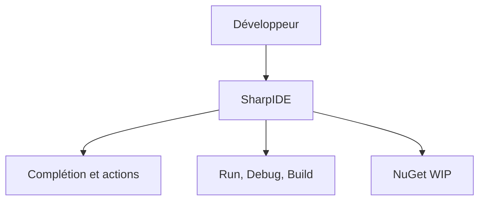

# MattParkerDev/SharpIDE

> Modern, cross-platform, open source .NET IDE, still under construction.

## The problem
The .NET ecosystem lacks a lightweight, free, cross-platform IDE to rival the big editors.

## What it actually does
The README is very short. It announces autocompletion, signature help, code actions, symbol info, Razor highlighting, run, debug, build, NuGet and the test explorer (the last two in progress). No technical detail is provided.

## How it is wired
Simplified diagram based on the sheet, no diagram provided.


## Trying it
```bash
xattr -d -r com.apple.quarantine /Applications/SharpIDE.app
sudo codesign --force --deep --sign - /Applications/SharpIDE.app
# Ces deux commandes servent à lancer l'app sous macOS Tahoe ; le build est dans CONTRIBUTING.md.
```

## Cost and gotchas
Free, MIT. The project says it is under development. On macOS Tahoe, the unsigned application requires removing the quarantine and re-signing it.

## What it is not
Not yet a replacement for an established IDE: several features are marked "in progress". The screenshots are not described in the text.

## Alternatives
No alternative named in the README.

## For you
Ignore: a still experimental .NET IDE, unrelated to data, AI or MLOps work.
