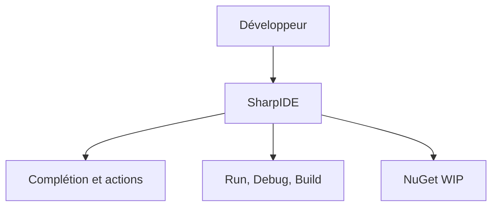

# MattParkerDev/SharpIDE

> IDE .NET moderne, multiplateforme et open source, encore en construction.

## Le problème
L'écosystème .NET manque d'un IDE léger, libre et multiplateforme face aux grands éditeurs.

## Ce que ça fait vraiment
Le README est très court. Il annonce l'autocomplétion, l'aide à la signature, les actions de code, les infos de symbole, la coloration Razor, l'exécution, le débogage, la compilation, NuGet et l'explorateur de tests (ces deux derniers en cours). Aucun détail technique n'est fourni.

## Comment c'est branché
Schéma simplifié d'après la fiche, sans diagramme fourni.


## Essayer
```bash
xattr -d -r com.apple.quarantine /Applications/SharpIDE.app
sudo codesign --force --deep --sign - /Applications/SharpIDE.app
# Ces deux commandes servent à lancer l'app sous macOS Tahoe ; le build est dans CONTRIBUTING.md.
```

## Coût et pièges
Gratuit, MIT. Le projet se dit en cours de développement. Sous macOS Tahoe, l'application non signée exige de retirer la quarantaine et de la re-signer.

## Ce que ce n'est pas
Pas encore un remplaçant d'IDE établi : plusieurs fonctions sont marquées « en cours ». Les captures d'écran ne sont pas décrites dans le texte.

## Alternatives
Aucune alternative nommée dans le README.

## Pour toi
À ignorer : IDE .NET encore expérimental, sans lien avec un travail data, IA ou MLOps.

