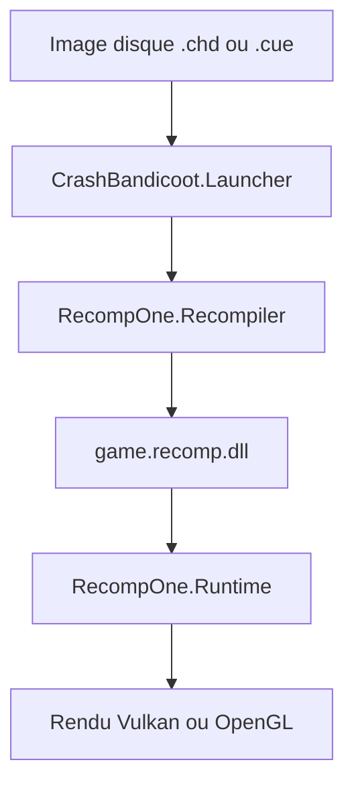

# Matteo842/CrashBandicoot-Launcher

> Unofficial launcher that recompiles Crash Bandicoot (PS1) into a native program, with widescreen and 240 FPS.

## The problem
The 1996 game runs in 4:3 and at a low frame rate on PC and mobile, or requires an emulator.

## What it actually does
The RecompOne recompiler translates the MIPS code of the disc you provide into C#, compiled on your machine. A runtime imitates enough of the PS1 (BIOS, GPU, sound, CD). Options: native 16:9, up to 240 FPS, 4K resolution, filters, quick save, cheats, C# mods. Available on Windows, Linux and Android.

## How it is wired


## Trying it
```bash
chmod +x CrashBandicoot-Linux
./CrashBandicoot-Linux --run /path/to/your/game.chd
chdman createcd -i "Crash Bandicoot.cue" -o "Crash Bandicoot.chd"
```

## Cost and gotchas
You need your own copy of the game (USA, SCUS-94900) and an OpenGL 3.3+ or Vulkan GPU. The first launch compiles the game, which takes time, especially on a Raspberry Pi. No telemetry according to the README.

## What it is not
Not an emulator, and the game is not included. Not affiliated with Sony or Activision. Work in progress: some levels still show the edges of the scenery.

## Alternatives
No alternative named in the README.

## For you
Ignore: retro gaming project unrelated to data or AI, despite a curious recompilation technique.
