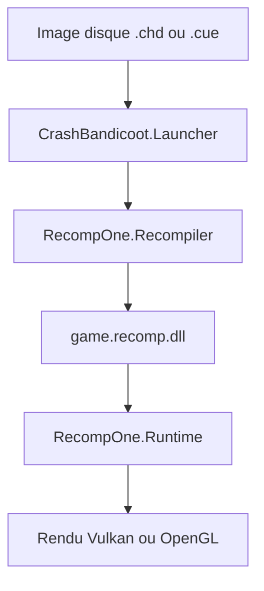

# Matteo842/CrashBandicoot-Launcher

> Lanceur non officiel qui recompile Crash Bandicoot (PS1) en programme natif, avec écran large et 240 FPS.

## Le problème
Le jeu de 1996 tourne en 4:3 et à basse cadence sur PC et mobile, ou demande un émulateur.

## Ce que ça fait vraiment
Le recompilateur RecompOne traduit le code MIPS du disque que tu fournis en C#, compilé sur ta machine. Un runtime imite assez de PS1 (BIOS, GPU, son, CD). Options : 16:9 natif, jusqu'à 240 FPS, résolution 4K, filtres, sauvegarde rapide, cheats, mods C#. Disponible sur Windows, Linux et Android.

## Comment c'est branché


## Essayer
```bash
chmod +x CrashBandicoot-Linux
./CrashBandicoot-Linux --run /path/to/your/game.chd
chdman createcd -i "Crash Bandicoot.cue" -o "Crash Bandicoot.chd"
```

## Coût et pièges
Il faut ta propre copie du jeu (USA, SCUS-94900) et un GPU OpenGL 3.3+ ou Vulkan. Le premier lancement compile le jeu, ce qui prend du temps, surtout sur Raspberry Pi. Pas de télémétrie selon le README.

## Ce que ce n'est pas
Pas un émulateur, et le jeu n'est pas inclus. Pas affilié à Sony ni à Activision. Travail en cours : certains niveaux montrent encore les bords du décor.

## Alternatives
Aucune alternative nommée dans le README.

## Pour toi
Ignorer : projet de jeu rétro sans rapport avec la data ou l'IA, malgré une technique de recompilation curieuse.

