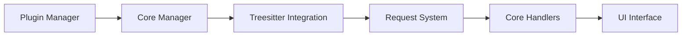

# MeanderingProgrammer/render-markdown.nvim

> Neovim plugin that renders Markdown visually inside the editor, with no external window.

## The problem
Reading raw Markdown in Neovim is painful: headings, tables and code blocks stay hard to read.

## What it actually does
Uses Treesitter and extmarks: heading icons, code blocks with language, lists, checkboxes, quotes, GitHub/Obsidian callouts, tables, links, LaTeX formulas. Switches between rendered and raw view depending on the mode. Only renders the visible area.

## How it is wired


## Trying it
```lua
{
    'MeanderingProgrammer/render-markdown.nvim',
    dependencies = { 'nvim-treesitter/nvim-treesitter', 'nvim-mini/mini.nvim' },
    opts = {},
}
```
Command: `:RenderMarkdown toggle`.

## Cost and gotchas
Free. Neovim >= 0.9 (0.10 recommended), a Nerd Font, markdown and markdown_inline parsers.

## What it is not
Not a browser preview. Images are not rendered natively. Incompatible with obsidian.nvim's UI.

## Alternatives
- headlines.nvim: the plugin the idea originally came from.

## For you
Adopt if you live in Neovim: an immediate reading gain for READMEs, notes and prompts.
