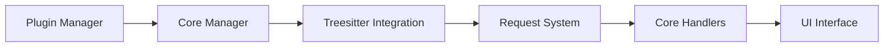

# MeanderingProgrammer/render-markdown.nvim

> Plugin Neovim qui rend le Markdown visuellement dans l'éditeur, sans fenêtre externe.

## Le problème
Lire du Markdown brut dans Neovim est pénible : titres, tableaux, blocs de code restent illisibles.

## Ce que ça fait vraiment
Utilise Treesitter et les extmarks : icônes de titres, blocs de code avec langage, listes, cases à cocher, citations, callouts GitHub/Obsidian, tableaux, liens, formules LaTeX. Bascule entre vue rendue et brute selon le mode. N'effectue le rendu que de la zone visible.

## Comment c'est branché


## Essayer
```lua
{
    'MeanderingProgrammer/render-markdown.nvim',
    dependencies = { 'nvim-treesitter/nvim-treesitter', 'nvim-mini/mini.nvim' },
    opts = {},
}
```
Commande : `:RenderMarkdown toggle`.

## Coût et pièges
Gratuit. Neovim >= 0.9 (0.10 conseillé), police Nerd Font, parsers markdown et markdown_inline.

## Ce que ce n'est pas
Pas un aperçu dans le navigateur. Les images ne sont pas rendues nativement. Incompatible avec l'UI d'obsidian.nvim.

## Alternatives
- headlines.nvim : plugin à l'origine de l'idée.

## Pour toi
À adopter si tu vis dans Neovim : gain de lecture immédiat pour README, notes et prompts.

