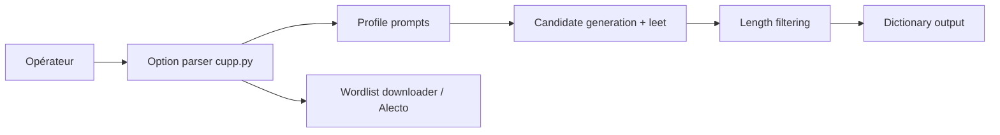

# Mebus/cupp

> Python script that generates password lists from a person's profile, for authorized tests.

## The problem
Assessing the strength of guessable passwords (dates, first names, pets) during a legal penetration test or an investigation.

## What it actually does
`cupp.py` asks interactive questions about the target, combines and transforms words (leet conversion, length filtering) and writes a dictionary. Other options improve an existing dictionary, download large lists or parse the Alecto database of default passwords. Configuration in `cupp.cfg`.

## How it is wired


## Trying it
```bash
python3 cupp.py -h
python3 cupp.py -i
```

## Cost and gotchas
Free, Python 3. Downloaded lists come from remote sources. The README insists on a legal framework (authorized tests, investigations); any other use is solely the user's responsibility.

## What it is not
Not a tool for auditing stored passwords or for encryption. Old project imported from remote-exploit; last push on 2026-07-17.

## Alternatives
No alternative named; WyD.pl and the Alecto database are possible inputs, not competitors.

## For you
Ignore: offensive use case unrelated to data/AI/MLOps work; keep only for authorized security tests.
