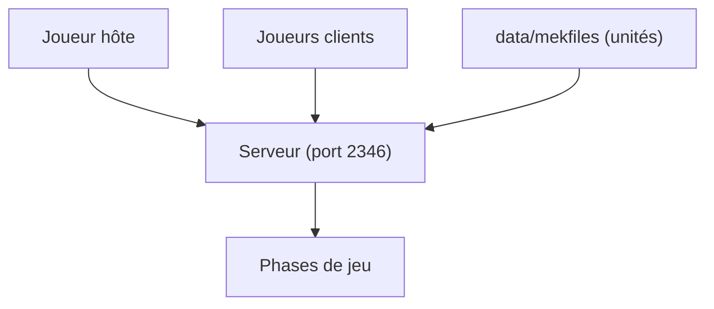

# MegaMek/megamek

> Java version of the BattleTech board game, playable over a network with the Total Warfare rules.

## The problem
Playing BattleTech remotely with friends requires software that applies the rules and manages turns.

## What it actually does
MegaMek implements the Total Warfare rules and part of Tactical Operations and Strategic Operations. It handles all unit types, generated maps and a lobby. One player hosts and the others connect over TCP/IP. You can also run a dedicated server and add your own units.

## How it is wired
Simplified diagram based on the sheet, no diagram provided.


## Trying it
```bash
java -jar MegaMek.jar
```

## Cost and gotchas
Free. Java 21 LTS minimum. Without a password, any player can reset the server or kick players. A license is present but not identified by GitHub.

## What it is not
It is not a complete game: some rules are missing. The README is truncated in the block.

## Alternatives
The README mentions MegaMekLab for creating units, and MekHQ.

## For you
Ignore: a board game, unrelated to data, AI or MLOps.
