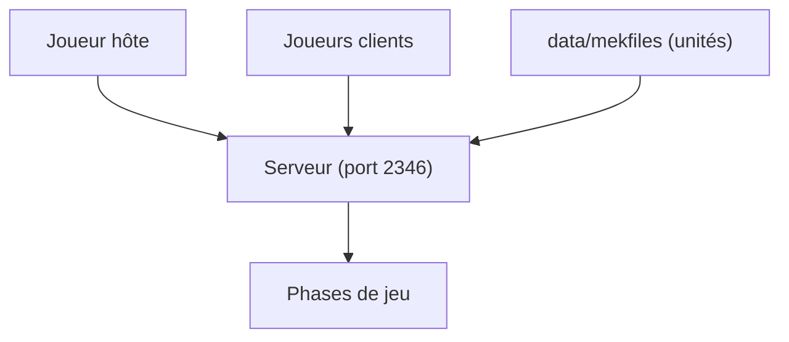

# MegaMek/megamek

> Version Java du jeu de plateau BattleTech, jouable en réseau avec les règles Total Warfare.

## Le problème
Jouer à BattleTech à distance avec des amis demande un logiciel qui applique les règles et gère les tours.

## Ce que ça fait vraiment
MegaMek implémente les règles de Total Warfare et une partie de Tactical Operations et Strategic Operations. Il gère tous types d'unités, des cartes générées et un salon. Un joueur héberge, les autres se connectent en TCP/IP. On peut aussi lancer un serveur dédié et ajouter ses propres unités.

## Comment c'est branché
Schéma simplifié d'après la fiche, sans diagramme fourni.


## Essayer
```bash
java -jar MegaMek.jar
```

## Coût et pièges
Gratuit. Java 21 LTS minimum. Sans mot de passe, tout joueur peut réinitialiser le serveur ou exclure des joueurs. La licence est présente mais non identifiée par GitHub.

## Ce que ce n'est pas
Ce n'est pas un jeu complet : des règles manquent. Le README est tronqué dans le bloc.

## Alternatives
Le README cite MegaMekLab pour créer des unités, et MekHQ.

## Pour toi
À ignorer : jeu de plateau, sans rapport avec la data, l'IA ou le MLOps.

