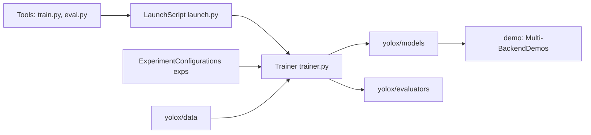

# Megvii-BaseDetection/YOLOX

> PyTorch implementation of YOLOX, an anchor-free object detector, with training and multi-backend export.

## The problem
Training and deploying a real-time detector requires reproducible training code and exports to several inference engines.

## What it actually does
Models from Nano to X (25.8 to 51.5 COCO mAP), pre-trained weights, experiment configs in `exps/`.
Image/video demo scripts, multi-GPU/multi-node training, batch evaluation, W&B logging.
Deployment demos: ONNX/ONNXRuntime, TensorRT, OpenVINO, ncnn, MegEngine.
Tutorials for custom data, caching, model freezing.

## How it is wired


## Trying it
```bash
git clone git@github.com:Megvii-BaseDetection/YOLOX.git
cd YOLOX
pip3 install -v -e .
python tools/demo.py image -n yolox-s -c /path/to/your/yolox_s.pth --path assets/dog.jpg --conf 0.25 --nms 0.45 --tsize 640 --save_result --device [cpu/gpu]
python -m yolox.tools.train -n yolox-s -d 8 -b 64 --fp16 -o [--cache]
```

## Cost and gotchas
Free, Apache-2.0; GPU for training. Last push June 2025, 808 open issues: little maintenance.

## What it is not
Not the current state of the art in detection; a 2021 reference. No guaranteed active support for new PyTorch versions.

## Alternatives
- StreamYOLO: YOLOX extension for streaming perception.
- YOLOX-ROS / YOLOX-deepstream: if you target robotics or DeepStream.

## For you
To ignore for a new project: solid code but little maintained; prefer recent YOLO families, keep YOLOX as a comparison baseline.
