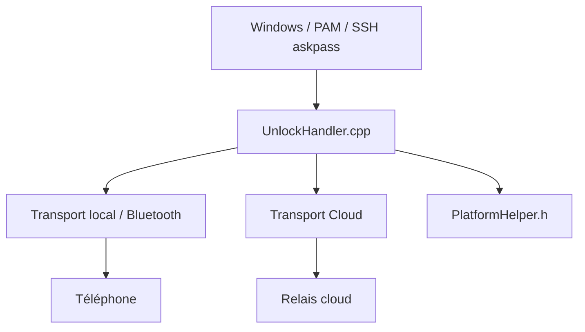

# MeisApps/pcbu-desktop

> PulseUnlock desktop application: unlock your PC or Mac by confirming with your phone.

## The problem
Typing your password at every lock, login or sudo prompt is a chore.

## What it actually does
The PC asks the paired phone (via QR code) for approval, and the phone sends back the key that decrypts the stored password. Transports: UDP, TCP, Bluetooth locally, or Cloud through a relay. It integrates with Windows, PAM on Linux, macOS and SSH. The normal password is still verified by the OS.

## How it is wired


## Trying it
```bash
tar -xzf PulseUnlock-CLI-x64.tar.gz
cd PulseUnlock-CLI-*-x64
sudo ./install.sh
sudo pulseunlock install
sudo pulseunlock pair
```

## Cost and gotchas
Cloud mode requires a subscription in the mobile app (unspecified). The phone app is separate. Sources can be built with CMake, C++23, OpenSSL 3 and Qt 6.

## What it is not
Not a password bypass: unlocking ends with the normal Windows or PAM verification.

## Alternatives
No alternative named in the README.

## For you
Ignore: workstation convenience utility, outside your data/AI/MLOps scope.
