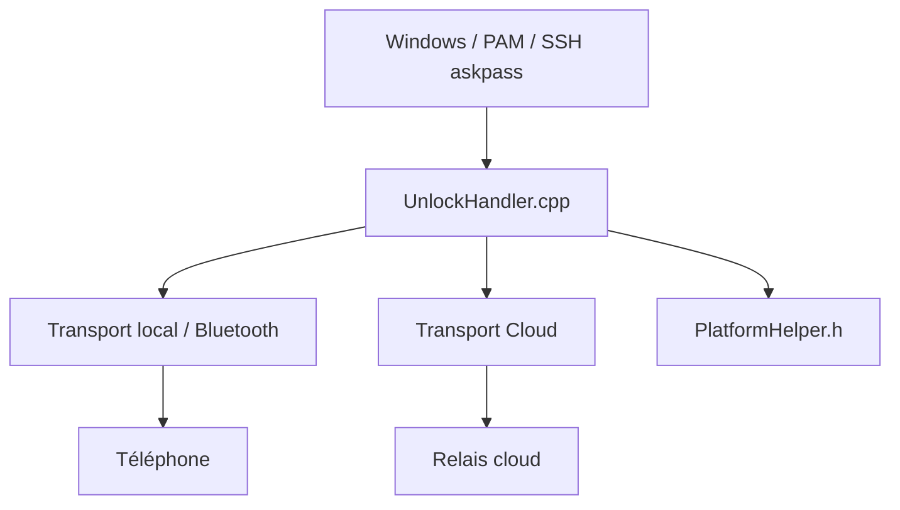

# MeisApps/pcbu-desktop

> Application de bureau PulseUnlock : déverrouiller son PC ou Mac en confirmant avec son téléphone.

## Le problème
Taper son mot de passe à chaque verrouillage, ouverture de session ou invite sudo est pénible.

## Ce que ça fait vraiment
Le PC demande l'approbation du téléphone appairé (QR code), qui renvoie la clé déchiffrant le mot de passe stocké. Transports : UDP, TCP, Bluetooth en local, ou Cloud via un relais. Il s'intègre à Windows, PAM sous Linux, macOS et SSH. Le mot de passe normal reste vérifié par l'OS.

## Comment c'est branché


## Essayer
```bash
tar -xzf PulseUnlock-CLI-x64.tar.gz
cd PulseUnlock-CLI-*-x64
sudo ./install.sh
sudo pulseunlock install
sudo pulseunlock pair
```

## Coût et pièges
Le mode Cloud demande un abonnement dans l'appli mobile (non précisé). L'appli téléphone est séparée. Sources compilables avec CMake, C++23, OpenSSL 3 et Qt 6.

## Ce que ce n'est pas
Pas un contournement du mot de passe : le déverrouillage finit par la vérification normale de Windows ou PAM.

## Alternatives
Aucune alternative nommée dans le README.

## Pour toi
À ignorer : utilitaire de confort pour poste de travail, hors de ton périmètre data/IA/MLOps.

