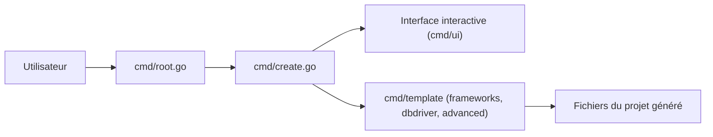

# Melkeydev/go-blueprint

> Command-line generator of Go project skeletons with a choice of HTTP framework and database.

## The problem
Starting a Go project means recreating the directory layout, the HTTP server and the database connection every time.

## What it actually does
The `go-blueprint create` command offers an interactive interface (or flags) to choose a name, a framework (Chi, Gin, Fiber, HttpRouter, Gorilla/mux, Echo), a database driver (Postgres, MySQL, Mongo, Redis, SQLite, ScyllaDB), advanced options (HTMX, Tailwind, React, CI/CD, Docker) and git initialization. It renders `text/template` templates into a new folder.

## How it is wired


## Trying it
```bash
go install github.com/melkeydev/go-blueprint@latest
npm install -g @melkeydev/go-blueprint
brew install go-blueprint
go-blueprint create --name my-project --framework gin --driver postgres --git commit
```

## Cost and gotchas
Free. You need Go and `$GOPATH/bin` on your PATH. The generated project is yours to maintain.

## What it is not
Not a framework: it generates code once, with no link to your project afterwards.

## Alternatives
No alternative named in the README.

## For you
Worth watching: useful for quickly spinning up a Go service (inference API, collector), but of no interest if you stay on Python.
